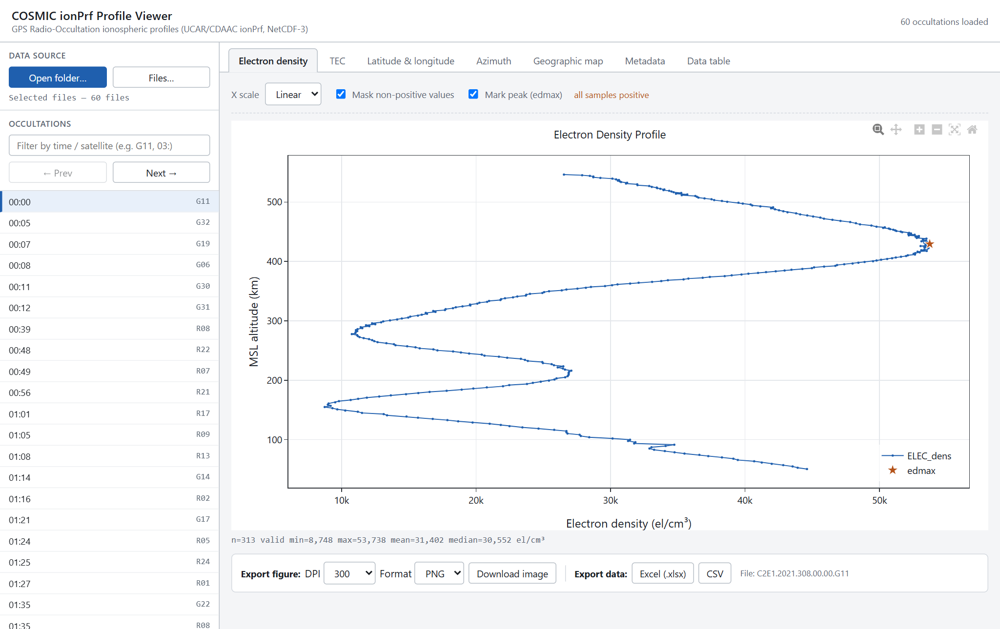
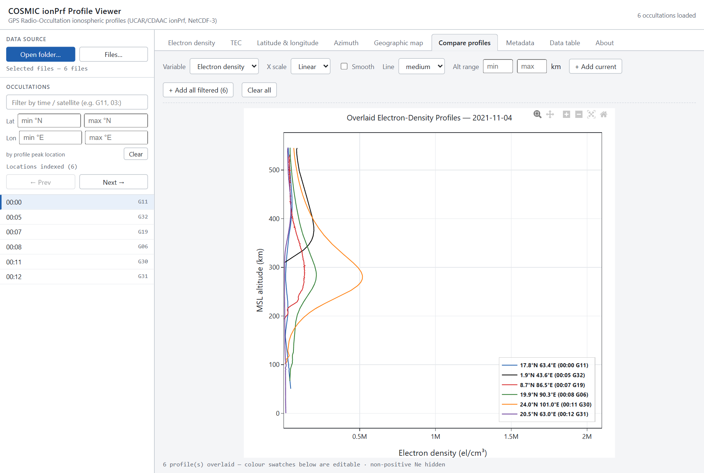

# COSMIC ionPrf Profile Viewer

A local, offline dashboard for **COSMIC GPS radio-occultation ionospheric
profiles** (UCAR/CDAAC `ionPrf` NetCDF files). Built for academic use — plain
and functional. Everything runs in the browser; no data is uploaded, nothing to
install.

Overlay multiple same-day profiles, each in a colour you choose:

## Run it

**Double-click `index.html`** (Chrome / Edge / Firefox). Plotly and SheetJS are
vendored in `lib/`, so it works fully offline.

1. Click **Open folder…** and choose a directory of your `ionPrf_*` files — or
   **Files…** to pick individual files.
2. Occultations are listed by **time** and **satellite** (PRN). Narrow the list
   by text (`G11`, `03:`, …), by **latitude/longitude range** (the viewer indexes
   each file's peak location in the background), or step with **Prev/Next**
   (↑/↓ keys).
3. Switch tabs to explore each profile.

## Views

| Tab | Shows |
|-----|-------|
| **Electron density** | `ELEC_dens` vs altitude. Linear/log X; **Mask non-positive** toggle (on by default; forced on for log) with a count of non-physical samples; optional **edmax** peak marker. |
| **TEC** | `TEC_cal` (calibrated occultation TEC below LEO orbit) vs altitude. |
| **Latitude & longitude** | `GEO_lat` and `GEO_lon` perigee-point coordinates vs altitude, side by side. |
| **Azimuth** | `OCC_azi` (occultation-plane azimuth w.r.t. north) vs altitude. |
| **Geographic map** | Perigee-point track on a coastline map, coloured by altitude, with the edmax point marked. |
| **Compare profiles** | Overlay many same-day profiles (electron density or TEC) on one plot, each in a distinct **user-chosen colour**, with a legend labelled by latitude/longitude and time. Build a group with the lat/lon filter then **Add all filtered**, or **Add current** one at a time; click any swatch to recolour. Display options: optional **line smoothing** (off by default — a visual aid only, the data is not resampled), **line width**, and an **altitude-range crop** to focus on the F-region. Exports at 300/600/1000 DPI like every other view. |
| **Metadata** | Observation time, satellite IDs, edmax & location, critical frequency, TEC params, endpoints, processing/provenance, and computed per-variable statistics. |
| **Data table** | All rows, raw values; `−999` fill values flagged in colour. |
| **About** | Tool description, author, repository and data-source links. |

All plots are interactive (zoom, pan, hover).

## Export

- **Figure** — pick **DPI** (300 / 600 / 1000) and **PNG** or **JPG**, then
  **Download image**. Files carry correct DPI metadata *and* the matching pixel
  resolution (a 300-DPI profile is 2280×1800 px), so they drop straight into a
  paper, LaTeX `\includegraphics`, or Word at the right print size.
- **Excel (.xlsx)** — one workbook, three sheets: `Profile_Data` (every
  parameter as a column, aligned by altitude), `Statistics` (min/max/mean/median/N
  per parameter), `Metadata` (all global attributes).
- **CSV** — the profile table as plain comma-separated text.

## Data-quality handling

- `−999` fill values are masked from plots and flagged in the table; raw values
  are preserved in CSV/Excel exports.
- Negative electron density is not physically meaningful — it is counted and
  masked, not silently plotted (toggle to inspect).
- The geographic track is the **perigee-point** path, not a full satellite
  ground track.

## Project layout

| File | Role |
|------|------|
| `index.html`, `styles.css` | UI |
| `app.js` | Load / list / plot / export logic |
| `netcdf3.js` | Self-contained classic NetCDF-3 reader (no dependencies) |
| `dpi-export.js` | PNG `pHYs` / JPEG JFIF DPI-metadata writer |
| `lib/plotly.min.js`, `lib/xlsx.full.min.js` | Vendored libraries (offline) |
| `COSMIC_ionPrf_file_documentation.md` | Technical description of the ionPrf product |

## Data source

ionPrf products are distributed by **UCAR/CDAAC**
(<https://cdaac-www.cosmic.ucar.edu/>). No data is bundled with this tool — load
your own ionPrf files from CDAAC. This viewer is independent and is not
affiliated with or endorsed by UCAR/CDAAC.
